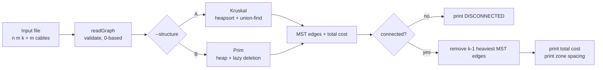
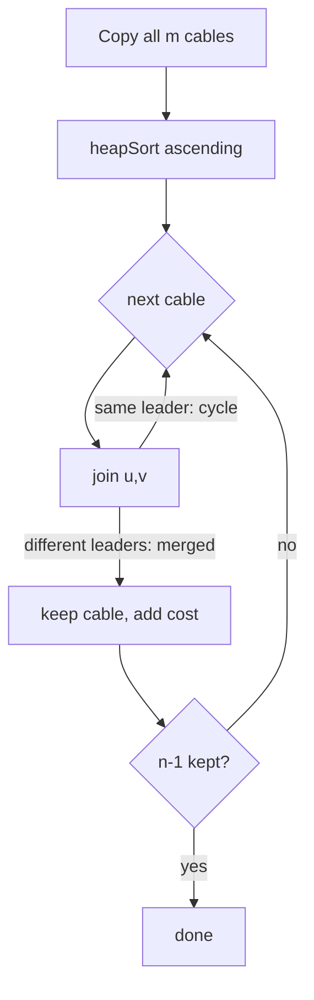
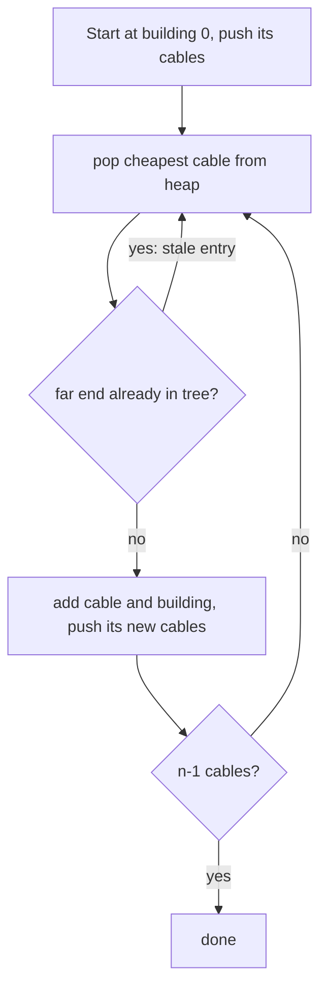
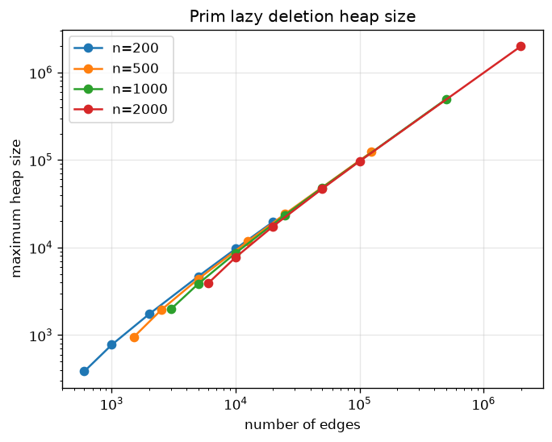

# Campus Network Cabling with Minimum Spanning Trees

**CS 203D / CS253 · End-term Mini Project · Problem 4**
Kruskal (heapsort + union-find) versus Prim (binary heap + lazy deletion), with zone spacing for `k` zones.

   

---

## 1. The problem

A campus has `n` buildings. Some pairs can be joined by a cable, and each possible cable has a cost. We must:

1. Connect **every** building with the **cheapest possible** set of cables (a Minimum Spanning Tree, MST).
2. Split the campus into **`k` zones** so that the buildings in different zones are as far apart in cable cost as possible. The number we report is the **zone spacing**.
3. Print `DISCONNECTED` if no cabling can reach every building.

We solved it twice, with two different algorithms, and compared them on correctness and speed.

| | Structure A | Structure B |
|---|---|---|
| Algorithm | **Kruskal** | **Prim** |
| Idea | Sort all cables, add the cheapest that creates no cycle | Grow one tree outward from a start building |
| Data structures | Heapsort + union-find (rank + path compression) | Binary min-heap with lazy deletion |
| Time | O(m log m) | O(m log m) |
| Source | `src/structA/` | `src/structB/` |

---

## 2. From input to output



### Input format

```
n m k          n buildings, m possible cables, k zones
u v w          one line per cable: building u, building v, cost w   (1-indexed)
```

Validation rules: `n >= 2`, `2 <= k <= n`, every building number is in `1..n`.

### Output format

```
<total cabling cost>
<zone spacing>
```

or the single word `DISCONNECTED`.

### Worked example (`tests/sample1.in`)

```
5 7 2
1 2 2
1 3 6
2 3 3
2 4 5
3 4 4
3 5 8
4 5 7
```

```
16
7
```

**Kruskal.** Heapsort gives the cables in order 2, 3, 4, 5, 6, 7, 8. Union-find rejects any cable whose ends already share a leader.

| Cable | Cost | Decision | Why |
|---|---|---|---|
| 1-2 | 2 | keep | joins two groups |
| 2-3 | 3 | keep | joins two groups |
| 3-4 | 4 | keep | joins two groups |
| 2-4 | 5 | skip | 2 and 4 are already connected (cycle) |
| 1-3 | 6 | skip | cycle |
| 4-5 | 7 | keep | joins building 5 |
| 3-5 | 8 | skip | cycle |

Kept: 2 + 3 + 4 + 7 = **16**. Stop as soon as `n - 1 = 4` cables are kept.

**Prim** from building 1 picks 1-2 (2), 2-3 (3), 3-4 (4), 4-5 (7): the same tree, the same **16**.

**Zones (k = 2).** Remove the `k - 1 = 1` heaviest MST cable (cost 7). Two zones remain, `{1,2,3,4}` and `{5}`, and the spacing between them is **7**.

---

## 3. How the two algorithms work

### Kruskal (Structure A)



* **Heapsort**: build a max-heap with `siftDown` from `size/2 - 1` down to 0, then repeatedly swap the root with the last unsorted element, shrink the heap by one and `siftDown(0)`. In-place, O(m log m), no worst-case surprises.
* **Union-find** keeps one leader per group of connected buildings.
  * **Union by rank**: hang the shorter tree under the taller one, so trees stay short.
  * **Path compression**: during `find`, point every visited building straight at the leader.
  * Together, `find` costs about O(α(n)), which is effectively constant.
* Stops early after `n - 1` cables. If fewer were kept, the graph is `DISCONNECTED`.

### Prim (Structure B)



* **Binary min-heap** holds candidate cables, keyed by cost.
* **Lazy deletion**: when a building joins the tree, old heap entries that now point into the tree are *not* removed. They are skipped when popped ("stale pops"). This avoids a decrease-key operation entirely.
* The heap can hold up to `m` entries, which is why memory grows with the number of cables (see Section 5.3).

### Why the two always agree

If all cable costs are distinct, the MST is unique, so both algorithms must return the same tree. When costs tie, the trees can differ, but the **total cost is always identical**. The tests check this, see Section 4.

---

## 4. Correctness evaluation

Every random case is solved by both algorithms and compared. Where the graph is connected and small enough, an independent **certificate check** also proves the answer is a true MST (it is a spanning tree, and no non-tree cable can replace a heavier tree cable on its path).


| Category | Cases | Passed | MST certified |
|---|---:|---:|---:|
| small connected | 400 | 400 | 400 |
| medium connected | 200 | 200 | 200 |
| dense | 100 | 100 | 100 |
| tree (already a tree) | 100 | 100 | 100 |
| special `k` (k = 2, k = n) | 100 | 100 | 100 |
| equal weights (ties) | 150 | 150 | 150 |
| disconnected | 150 | 150 | n/a (must print `DISCONNECTED`) |
| large connected | 5 | 5 | n/a (too big for the certificate) |
| large disconnected | 2 | 2 | n/a |
| **Total** | **1,207** | **1,207** | **1,050** |

Full per-case log: [`results/correctness.csv`](results/correctness.csv) (columns: case, category, n, m, k, both totals, both spacings, certificate, pass). Random seed is fixed (42), so every run is reproducible.

Other suites:

| Suite | Result |
|---|---|
| `test_structA` (Kruskal unit tests) | 212 checks passed |
| `test_structB` (Prim unit tests) | 211 checks passed |
| Sample 1 | `16` and `7` |
| Hard cases (`tests/hard_cases.cpp`) | tricky graph shapes written by member 6 (see the file for the list) |

---

## 5. Performance evaluation

All timings are the **median of 5 runs**, in milliseconds, on one machine (see Section 5.5). Graphs are random connected graphs. Raw data: [`results/timings_raw.csv`](results/timings_raw.csv), summary: [`results/timings_summary.csv`](results/timings_summary.csv).

### 5.1 Runtime versus density


| n | cables (m) | cables / building | Kruskal (ms) | Prim (ms) | Winner |
|---:|---:|---:|---:|---:|---|
| 200 | 600 | 3 | 0.057 | 0.123 | Kruskal 2.1x |
| 200 | 19,900 | 99.5 | 2.553 | 2.309 | Prim 1.1x |
| 500 | 1,500 | 3 | 0.166 | 0.357 | Kruskal 2.2x |
| 500 | 124,750 | 249.5 | 24.057 | 14.648 | Prim 1.6x |
| 1,000 | 3,000 | 3 | 0.352 | 0.819 | Kruskal 2.3x |
| 1,000 | 50,000 | 50 | 7.276 | 6.697 | Prim 1.1x |
| 1,000 | 499,500 | 499.5 | 121.151 | 52.835 | Prim 2.3x |
| 2,000 | 6,000 | 3 | 0.780 | 1.873 | Kruskal 2.4x |
| 2,000 | 50,000 | 25 | 7.841 | 7.824 | tie |
| 2,000 | 100,000 | 50 | 16.265 | 13.600 | Prim 1.2x |
| 2,000 | 1,999,000 | 999.5 | 847.389 | 244.610 | **Prim 3.5x** |

The full 24-row table is in `results/timings_summary.csv`. **Kruskal wins 17 of the 24 settings (all the sparse ones); Prim wins the other 7 (all the dense ones).**

### 5.2 Where Kruskal and Prim cross over


Measured by sweeping density from 0.5% to 100% of all possible cables (`results/crossover.csv`). A negative margin means Kruskal is faster.

| n | Density when Prim first wins | Margin at 100% density |
|---:|---|---:|
| 500 | about 40% (m = 49,900) | Prim 38.9% faster |
| 1,000 | about 10% (m = 49,950) | Prim 57.9% faster |
| 2,000 | about 5% (m = 99,950) | Prim 70.4% faster |

The crossover moves toward **sparser** graphs as `n` grows. In terms of cables per building it sits between roughly 25 and 50.

### 5.3 Why they diverge

**Kruskal pays to sort every cable.** Heapsort costs O(m log m) no matter how the graph looks. On a sparse graph that is cheap, and the early exit after `n - 1` kept cables sometimes avoids a lot of union-find work. On a dense graph, `m` is huge and nearly all the time goes into sorting millions of cables that are never used.

**Prim never sorts.** It only pops from a heap, and (see below) it pops far fewer entries than `m`. As density rises, Prim's work grows much slower than Kruskal's. The price is memory and a heavier loop on sparse graphs.

Heap behaviour of Prim ([`results/prim_heap.csv`](results/prim_heap.csv)):



| n | m | Max heap size | Pushes | Pops | Stale pops |
|---:|---:|---:|---:|---:|---:|
| 1,000 | 3,000 | 1,980 | 3,000 | 2,919 | 1,920 |
| 1,000 | 499,500 | 497,467 | 499,500 | 3,136 | 2,137 |
| 2,000 | 6,000 | 3,918 | 6,000 | 5,979 | 3,980 |
| 2,000 | 1,999,000 | 1,994,307 | 1,999,000 | 8,053 | 6,054 |

* The heap grows to almost `m` entries (about **99.8%** at the densest setting), so **Prim's memory is O(m)** with lazy deletion.
* On the densest graph, Prim pushes 1,999,000 entries but pops only 8,053, so the algorithm stops almost immediately once the tree is complete. Roughly **75%** of those pops are stale and thrown away.
* Kruskal, by contrast, must heapsort all 1,999,000 cables first. That is the whole gap.

### 5.4 Union-find ablation: does path compression help?


| n | m | With compression (ms) | Without (ms) | Gain |
|---:|---:|---:|---:|---:|
| 2,000 | 20,000 | 2.548 | 2.580 | 1.2% |
| 20,000 | 60,000 | 9.666 | 10.262 | 5.8% |
| 20,000 | 200,000 | 38.449 | 40.881 | 6.0% |
| 50,000 | 250,000 | 57.261 | 62.258 | 8.0% |

The benefit is small but grows with `n`. Union by rank already keeps trees very short, so compression adds only a modest extra. Heapsort dominates Kruskal's time, which is why even a perfect union-find could not close the gap with Prim on dense graphs.

### 5.5 Test machine

| Item | Value |
|---|---|
| CPU | AMD Ryzen 9 8945HS w/ Radeon 780M Graphics |
| RAM | 16 GB |
| OS | Windows (x64), Rohith's laptop |
| Compiler | g++ 15.2.0 (Rev8, built by the MSYS2 project), `-O2 -std=c++17` |

---

## 6. Conclusions

1. **Both algorithms are correct.** 1,207 random cases, 0 failures, and 1,050 answers independently certified as true MSTs. Totals and spacings always agreed.
2. **Choose by density.** Kruskal is up to **2.4x faster** on sparse graphs (about 3 cables per building). Prim is up to **3.5x faster** on dense graphs (n = 2,000, complete graph: 847 ms against 245 ms).
3. **The crossover is around 25 to 50 cables per building**, or about 5% to 40% density depending on `n`, moving to sparser graphs as `n` grows.
4. **Trade-off**: Prim's lazy heap needs O(m) memory; Kruskal needs O(m) for the sorted copy as well, but has the more predictable running time.
5. **A real campus is sparse** (a building connects to a handful of neighbours), so Kruskal is the better practical choice for this application.

### Known limitations

* The certificate check is skipped on the 7 largest cases because it would take too long.
* Timings come from one machine and will differ elsewhere, although the crossover shape should hold.
* Costs are stored as `long long`, so totals up to about 9 x 10^18 are safe.

---

## 7. Build and run

Requirements: C++17 compiler (g++), Python 3 with matplotlib for the charts, Windows PowerShell (also works on Linux).

```powershell
.\build.ps1                                   # compile everything
.\test.ps1                                    # all tests
.\bench.ps1                                   # timings + figures

Get-Content tests\sample1.in | .\run --structure A
Get-Content tests\sample1.in | .\run --structure B
.\run --structure A --no-compress             # disable path compression
.\run --generate 1000 60 5 1 > campus.in      # n, radius, k, seed
```

## 8. Repository layout

```
app/            main.cpp, generator.cpp
src/common/     graph.cpp (input), bfs.cpp, zones.cpp
src/structA/    heapsort.cpp, unionfind.cpp, kruskal.cpp
src/structB/    minheap.cpp, prim.cpp
tests/          unit tests, random differential test, hard cases, samples
bench/          benchmark.cpp, crossover.cpp, plot.py
results/        CSV data and figures/ (charts)
REPORT.md       answers to Q1 to Q6
```

All `.cpp` files include each other directly, so compile only the entry file (for example `app/main.cpp`) and never list `src/*.cpp` on the g++ line.

## 9. Team

| Role | Name | Roll number | GitHub |
|---|---|---|---|
| 1. Kruskal (Structure A) | Rohith M S | 250005038 | rohithsuresh21 |
| 2. Prim (Structure B) | Sheik Rehan Sharief | 250003071 | Rayhann12345 |
| 3. Application | Sakthi P | 250003067 | sakthi220107-cmyk |
| 4. Correctness and testing | Parthasarathy S | 250002046 | Sarathy-10 |
| 5. Measurements and charts | Bhavan Jeeth A | 250004010 | bhavan12391 |
| 6. Hard cases and crossover | Kavin Krishnan S| 250005022 | kavin-krishnan|

AI assistance (Claude) is declared per member in `tests/TOOLS.md`.
