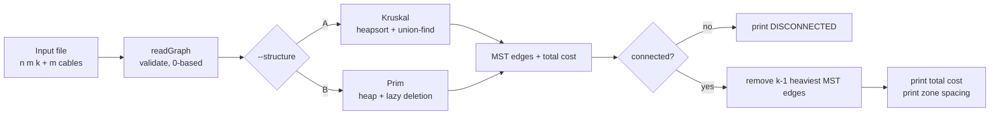
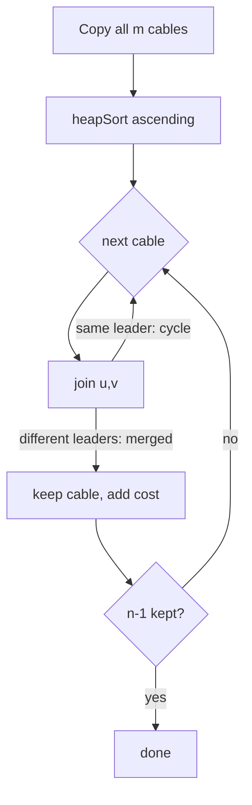
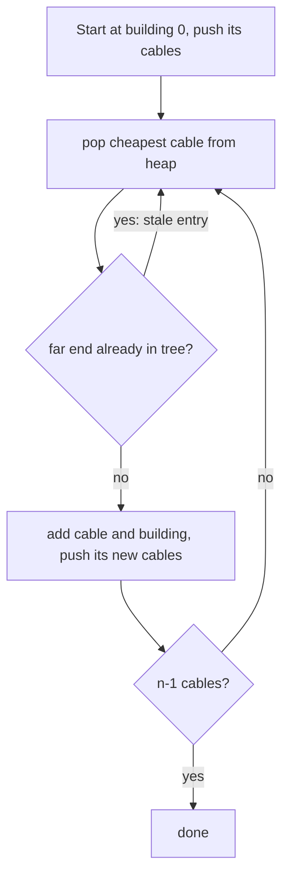
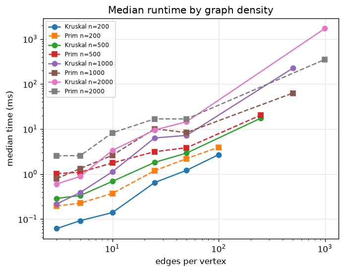
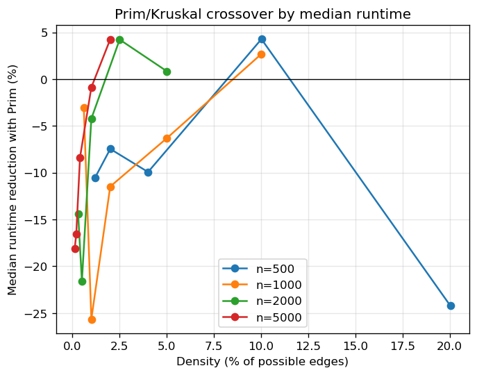
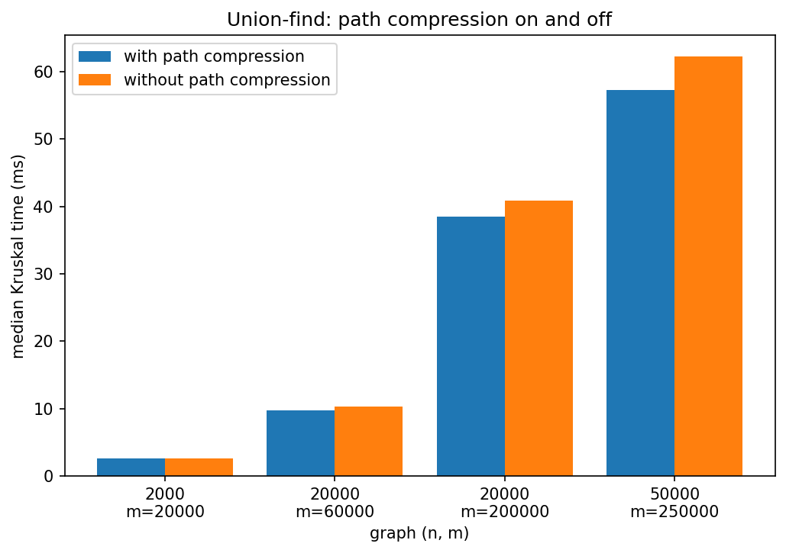

# Campus Network Cabling with Minimum Spanning Trees

**CS 203D / CS253 · End-term Mini Project · Problem 4**
Kruskal (heapsort + union-find) versus Prim (binary heap + lazy deletion), with zone spacing for `k` zones.

   

---

## 1. The problem

A campus has `n` buildings. Some pairs can be joined by a cable, and each possible cable has a cost. We must:

1. Connect **every** building with the **cheapest possible** set of cables (a Minimum Spanning Tree, MST).
2. Split the campus into **`k` zones** so that the buildings in different zones are as far apart in cable cost as possible. The number we report is the **zone spacing**.
3. Print `DISCONNECTED` if no cabling can reach every building.

We solved it twice, with two different algorithms, and compared them on correctness and speed.

| | Structure A | Structure B |
|---|---|---|
| Algorithm | **Kruskal** | **Prim** |
| Idea | Sort all cables, add the cheapest that creates no cycle | Grow one tree outward from a start building |
| Data structures | Custom heapsort + union-find (rank + path compression) | Adjacency lists + custom binary min-heap with lazy deletion |
| Time | O(m log m) | O(m log m) |
| Source | `src/structA/` | `src/structB/` |

---

## 2. From input to output



### Input format

```
n m k          n buildings, m possible cables, k zones
u v w          one line per cable: building u, building v, cost w   (1-indexed)
```

Validation rules include `n >= 2`, `m >= 0`, `2 <= k <= n`, and building numbers
in `1..n`. Invalid input produces a diagnostic on standard error and exit code 2.

### Output format

```
<total cabling cost>
<zone spacing>
```

or the single word `DISCONNECTED`.

### Worked example (`tests/sample1.in`)

```
5 7 2
1 2 2
1 3 6
2 3 3
2 4 5
3 4 4
3 5 8
4 5 7
```

```
16
7
```

**Kruskal.** Heapsort gives the cables in order 2, 3, 4, 5, 6, 7, 8. Union-find rejects any cable whose ends already share a leader.

| Cable | Cost | Decision | Why |
|---|---|---|---|
| 1-2 | 2 | keep | joins two groups |
| 2-3 | 3 | keep | joins two groups |
| 3-4 | 4 | keep | joins two groups |
| 2-4 | 5 | skip | 2 and 4 are already connected (cycle) |
| 1-3 | 6 | skip | cycle |
| 4-5 | 7 | keep | joins building 5 |
| 3-5 | 8 | skip | cycle |

Kept: 2 + 3 + 4 + 7 = **16**. Stop as soon as `n - 1 = 4` cables are kept.

**Prim** from building 1 picks 1-2 (2), 2-3 (3), 3-4 (4), 4-5 (7): the same tree, the same **16**.

**Zones (k = 2).** Remove the `k - 1 = 1` heaviest MST cable (cost 7). Two zones remain, `{1,2,3,4}` and `{5}`, and the spacing between them is **7**.

---

## 3. How the two algorithms work

### Kruskal (Structure A)



* **Heapsort**: build a max-heap with `siftDown` from `size/2 - 1` down to 0, then repeatedly swap the root with the last unsorted element, shrink the heap by one and `siftDown(0)`. In-place, O(m log m), no worst-case surprises.
* **Union-find** keeps one leader per group of connected buildings.
  * **Union by rank**: hang the shorter tree under the taller one, so trees stay short.
  * **Path compression**: during `find`, point every visited building straight at the leader.
  * Together, `find` costs about O(α(n)), which is effectively constant.
* Stops early after `n - 1` cables. If fewer were kept, the graph is `DISCONNECTED`.

### Prim (Structure B)



* **Binary min-heap** holds candidate cables, keyed by cost.
* **Lazy deletion**: when a building joins the tree, old heap entries that now point into the tree are *not* removed. They are skipped when popped ("stale pops"). This avoids a decrease-key operation entirely.
* The heap can hold up to `m` entries, which is why memory grows with the number of cables (see Section 5.3).

### Why the two always agree

If all cable costs are distinct, the MST is unique, so both algorithms must return the same tree. When costs tie, the trees can differ, but the **total cost is always identical**. The tests check this, see Section 4.

---

## 4. Correctness evaluation

Every random case is solved by both algorithms and compared. Where the graph is connected and small enough, an independent **certificate check** also proves the answer is a true MST (it is a spanning tree, and no non-tree cable can replace a heavier tree cable on its path).


| Category | Cases | Passed | MST certified |
|---|---:|---:|---:|
| small connected | 400 | 400 | 400 |
| medium connected | 200 | 200 | 200 |
| dense | 100 | 100 | 100 |
| tree (already a tree) | 100 | 100 | 100 |
| special `k` (k = 2, k = n) | 100 | 100 | 100 |
| equal weights (ties) | 150 | 150 | 150 |
| disconnected | 150 | 150 | n/a (must print `DISCONNECTED`) |
| large connected | 5 | 5 | n/a (too big for the certificate) |
| large disconnected | 2 | 2 | n/a |
| **Total** | **1,207** | **1,207** | **1,050** |

Full per-case log: [`results/correctness.csv`](results/correctness.csv) (columns: case, category, n, m, k, both totals, both spacings, certificate, pass). Random seed is fixed (42), so every run is reproducible.

Other suites:

| Suite | Result |
|---|---|
| `test_structA` (Kruskal unit tests) | 212 checks passed |
| `test_structB` (Prim unit tests) | 211 checks passed |
| Sample 1 | `16` and `7` |
| Adversarial cases (`bench/test_adversarial.cpp`) | Graph-generation checks for chains, stars, equal-weight graphs, bridges, disconnected graphs, and more |

---

## 5. Performance evaluation

The runtime and path-compression results report the **median of five timed runs**, in milliseconds. Graphs are random connected graphs. Raw data: [`results/timings_raw.csv`](results/timings_raw.csv), summary: [`results/timings_summary.csv`](results/timings_summary.csv).

### 5.1 Runtime versus density



| n | cables (m) | cables / building | Kruskal (median ms) | Prim (median ms) | Winner |
|---:|---:|---:|---:|---:|---|
| 200 | 600 | 3.0000 | 0.062 | 0.196 | Kruskal 3.17x |
| 200 | 19,900 | 99.5000 | 2.684 | 3.924 | Kruskal 1.46x |
| 500 | 1,500 | 3.0000 | 0.288 | 1.024 | Kruskal 3.56x |
| 500 | 124,750 | 249.5000 | 17.462 | 20.407 | Kruskal 1.17x |
| 1,000 | 3,000 | 3.0000 | 0.217 | 0.795 | Kruskal 3.67x |
| 1,000 | 50,000 | 50.0000 | 7.238 | 8.349 | Kruskal 1.15x |
| 1,000 | 499,500 | 499.5000 | 225.130 | 62.950 | Prim 3.58x |
| 2,000 | 6,000 | 3.0000 | 0.604 | 2.551 | Kruskal 4.22x |
| 2,000 | 50,000 | 25.0000 | 9.523 | 16.818 | Kruskal 1.77x |
| 2,000 | 100,000 | 50.0000 | 14.548 | 16.793 | Kruskal 1.15x |
| 2,000 | 1,999,000 | 999.5000 | 1714.276 | 350.875 | Prim 4.89x |

The full 24-row table is in `results/timings_summary.csv`. **Kruskal wins 22 of 24 settings, Prim wins 2, and 0 tie.**

### 5.2 Where Kruskal and Prim cross over



The crossover sweep uses random connected graphs with 500, 1,000, and 2,000
vertices at densities from about 1% to 100%. Each point compares the median
runtimes from five fresh in-process trials per algorithm. A negative margin
means Kruskal is faster. The [crossover benchmark notes](results/README.md)
describe the timing method, correctness checks, and how to reproduce the
[measurements](results/crossover.csv).

| Vertices | First tested density where Prim wins | Prim median runtime reduction at 100% |
|---:|---:|---:|
| 500 | 20.0% (m = 24,950) | 45.9% |
| 1,000 | 5.0% (m = 24,975) | 63.1% |
| 2,000 | 2.5% (m = 49,975) | 78.3% |

### 5.3 Why they diverge

**Kruskal pays to sort every cable.** Heapsort costs O(m log m) no matter how the graph looks. On a sparse graph that is cheap, and the early exit after `n - 1` kept cables sometimes avoids a lot of union-find work. On a dense graph, `m` is huge and nearly all the time goes into sorting millions of cables that are never used.

**Prim never sorts.** It only pops from a heap, and (see below) it pops far fewer entries than `m`. As density rises, Prim's work grows much slower than Kruskal's. The price is memory and a heavier loop on sparse graphs.

Heap behaviour of Prim ([`results/prim_heap.csv`](results/prim_heap.csv)):


| n | m | Max heap size | Pushes | Pops | Stale pops |
|---:|---:|---:|---:|---:|---:|
| 1,000 | 3,000 | 1,980 | 3,000 | 2,919 | 1,920 |
| 1,000 | 499,500 | 497,467 | 499,500 | 3,135 | 2,136 |
| 2,000 | 6,000 | 3,918 | 6,000 | 5,979 | 3,980 |
| 2,000 | 1,999,000 | 1,994,306 | 1,999,000 | 8,053 | 6,054 |

* The heap grows to almost `m` entries (about **99.8%** at the densest setting), so **Prim's memory is O(m)** with lazy deletion.
* On the densest graph, Prim pushes 1,999,000 entries but pops only 8,053, so the algorithm stops almost immediately once the tree is complete. Roughly **75%** of those pops are stale and thrown away.
* Kruskal, by contrast, must heapsort all 1,999,000 cables first. That is the whole gap.

### 5.4 Union-find ablation: does path compression help?



| n | m | With compression (median ms) | Without (median ms) | Gain |
|---:|---:|---:|---:|---:|
| 2,000 | 20,000 | 0.956 | 0.972 | 1.6% |
| 20,000 | 60,000 | 3.346 | 3.760 | 11.0% |
| 20,000 | 200,000 | 13.196 | 14.419 | 8.5% |
| 50,000 | 250,000 | 17.493 | 21.908 | 20.2% |

The comparison measures the full Kruskal call, with union by rank enabled in both modes. Each median comes from five trials in [the path-compression raw log](results/union_find_raw.csv). These trials were rerun locally with GCC 13.1.0 and `-O2 -std=c++17`.

### 5.5 Original test machine

| Item | Value |
|---|---|
| CPU | AMD Ryzen 9 8945HS w/ Radeon 780M Graphics |
| RAM | 16 GB |
| OS | Windows (x64), Rohith's laptop |
| Compiler | g++ 15.2.0 (Rev8, built by the MSYS2 project), `-O2 -std=c++17` |

---

## 6. Conclusions

1. **Both algorithms are correct.** 1,207 random cases, 0 failures, and 1,050 answers independently certified as true MSTs. Totals and spacings always agreed.
2. **Choose by density.** At 2,000 buildings, Kruskal 4.22x on the graph with 6,000 cables, and Prim 4.89x on the complete graph. These ratios use the recorded medians.
3. **The crossover depends on graph size and density.** The density sweep shows where each algorithm had the lower median on the measured graphs.
4. **Trade-off**: Prim's lazy heap needs O(m) memory; Kruskal needs O(m) for the sorted copy as well, but has the more predictable running time.
5. **A real campus is sparse** (a building connects to a handful of neighbours), so Kruskal is the better practical choice for this application.

### Known limitations

* The certificate check is skipped on the 7 largest cases because it would take too long.
* The runtime-by-density table uses the archived trials. The path-compression
  and crossover tables use separate reruns. Timings vary by machine and workload.
* Cable costs and accumulated totals must fit in `long long`.
* The campus generator checks every building pair and accepts up to 20,000 buildings. A small radius can produce a disconnected graph.

---

## 7. Build and run

Use a C++17-capable `g++` on PATH (for example, GCC via MinGW-w64/MSYS2
on Windows). The Unix launcher uses Bash. Windows has PowerShell and Command
Prompt launchers. PowerShell also runs the test and benchmark scripts.
Python 3 with Matplotlib is needed to redraw the charts.

Run these examples from the repository root. The launchers compile the
application and print its answer to standard output.

**Linux/macOS (Bash)**

```bash
./run --structure A < tests/sample1.in
./run --structure B < tests/sample1.in
./run --generate 1000 60 5 1 > campus.in
```

**Windows PowerShell**

```powershell
Get-Content -Raw tests/sample1.in | .\run.ps1 --structure A
Get-Content -Raw tests/sample1.in | .\run.ps1 --structure B
```

**Windows Command Prompt**

```bat
run.bat --structure A < tests\sample1.in
run.bat --structure B < tests\sample1.in
```

Use `--structure A --no-compress` to run Kruskal with path compression
disabled. To build once, run `g++ -std=c++17 -O2 app/main.cpp -o program`
on Linux/macOS or use `-o program.exe` on Windows. Pass the same application
arguments to the compiled executable.

Run `.\tests\test.ps1` and `.\bench\bench.ps1` from the repository root in
Windows PowerShell. See the [test instructions](tests/README.md) and
[benchmark instructions](bench/README.md) for Unix commands and output paths.

## 8. Repository layout

| Path | Contents |
|---|---|
| [`app/`](app/) | `main.cpp` and `generator.h` |
| [`src/common/`](src/common/) | `graph.h` (input), `bfs.h` (connectivity), and `zones.h` (spacing) |
| [`src/structA/`](src/structA/) | `kruskal.h`, `heapsort.h`, and `unionfind.h` |
| [`src/structB/`](src/structB/) | `prim.h` and `minheap.h` |
| [`tests/`](tests/) | Unit tests, differential tests, and sample input/output |
| [`bench/`](bench/) | Benchmarks, adversarial graph tools and tests, crossover report, and plotting |
| [`results/`](results/) | CSV logs and generated figures |
| [`TOOLS.md`](TOOLS.md) | Tool disclosures and individual contributions |

The shared and algorithm implementations are headers. Compile `app/main.cpp`
on its own. The adversarial graph tools, tests, and crossover analysis also
link `bench/adversarial_cases.cpp`.

## 9. Team

| Role | Name | Roll number | GitHub | Analysis question |
|---|---|---|---|---|
| 1. Kruskal (Structure A) | Rohith M S | 250005038 | rohithsuresh21 | [Q1: Cut property through an exchange argument](REPORT.md#q1-cut-property-through-an-exchange-argument) |
| 2. Prim (Structure B) | Sheik Rehan Sharief | 250003071 | Rayhann12345 | [Q2: Kruskal's correctness, including ties and cycle detection](REPORT.md#q2-why-kruskal-is-correct-ties-and-cycle-detection) |
| 3. Application | Sakthi P | 250003067 | sakthi220107-cmyk | [Q3: Union-by-rank height bound and path compression](REPORT.md#q3-union-by-rank-height-and-path-compression) |
| 4. Correctness and testing | Parthasarathy S | 250002046 | Sarathy-10 | [Q4: Prim's binary min-heap and lazy-deletion complexity](REPORT.md#q4-prims-lazy-heap-complexity-and-heap-bound) |
| 5. Measurements and charts | Bhavan Jeeth A | 250004010 | bhavan12391 | [Q5: Maximum-spacing k-zone clustering using MST](REPORT.md#q5-why-removing-the-k--1-heaviest-mst-edges-maximizes-spacing) |
| 6. Hard cases and crossover | Kavin Krishnan S | 250005022 | kavin-krishnan | [Q6: Measured crossover between Kruskal and Prim](REPORT.md#q6-measured-crossover-between-prim-and-kruskal) |

