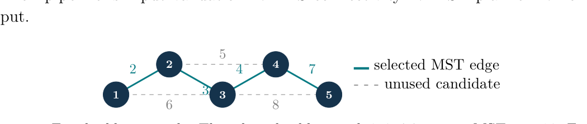
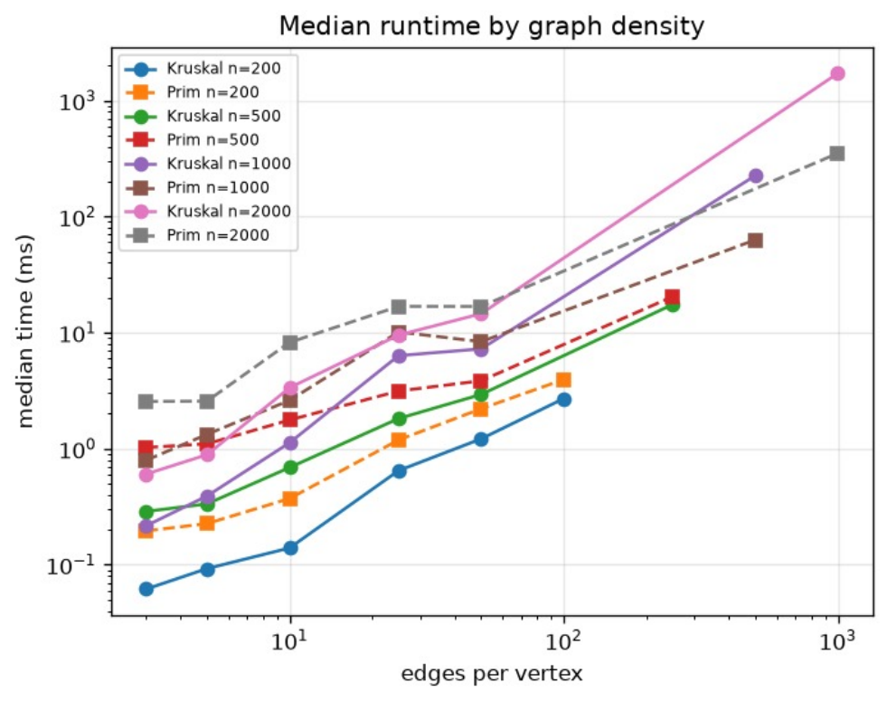
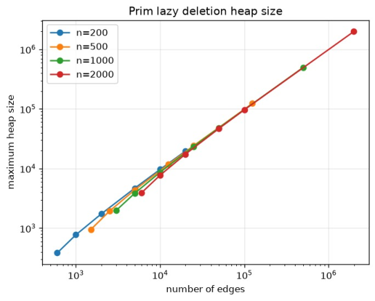
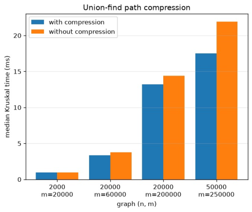
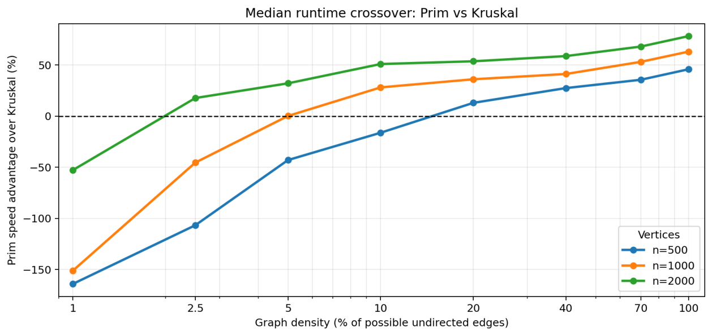

# Campus Network Cabling with Minimum Spanning Trees

**Indian Institute of Technology Indore**  
**CS253 / MA253 — Data Structures and Algorithms Laboratory — Mini-Project 4**  
*Kruskal vs. Prim: design, correctness, and empirical crossover*

**Project repository:** https://github.com/rohithsuresh21/cs253-sakthi-and-team-p4

## Team information

| No. | Name | Roll number | GitHub username |
|---:|---|---|---|
| 1 | Rohith M. S. | 250005038 | rohithsuresh21 |
| 2 | Sheik Rehan Sharief | 250003071 | Rayhann12345 |
| 3 | Sakthi P. | 250003067 | sakthi220107-cmyk |
| 4 | Parthasarathy S. | 250002046 | Sarathy-10 |
| 5 | Bhavan Jeeth A. | 250004010 | bhavan12391 |
| 6 | Kavin Krishnan S. | 250005022 | kavin-krishnan |

## Abstract

A campus network should connect all buildings at minimum cable cost and divide them into *k* well-separated maintenance zones. We implement two minimum spanning tree (MST) planners from scratch: Kruskal with heapsort and disjoint-set union, and Prim with an adjacency list and a binary min-heap using lazy deletion. A common command-line interface checks connectivity and reports MST cost and maximum-spacing zoning. The integrated correctness log contains **1,207 passing cases** and **1,050 MST certificates**. In the recorded 24-setting runtime study, Kruskal wins 22 cases and Prim wins two complete-graph cases. A separate median-based density sweep locates more detailed crossover intervals. We explain the algorithmic trade-offs and the limits of the measured evidence.

> **Key result.** Both planners agree on the required outputs. Kruskal is preferable for the sparse workloads measured, whereas Prim can win on dense graphs; its lazy heap may nevertheless require O(E) memory.

## 1. Team and contributions

| Member | Role / question | Implemented contribution |
|---|---|---|
| Rohith M. S. | Structure A / Q1 | Custom heapsort, union–find with optional path compression, Kruskal and unit tests. |
| Rehan Sharief | Structure B / Q2 | Custom binary min-heap, adjacency-list Prim, lazy deletion, heap counters and unit tests. |
| Sakthi P. | Application / Q3 | Input and optional graph generation, BFS connectivity, planner selection and *k*-zone spacing output. |
| Parthasarathy | Testing / Q4 | Random differential cases, independent MST certificate, spacing checker and correctness records. |
| Bhavan Jeeth | Measurement / Q5 | Timing experiments, path-compression comparison, Prim heap-size recording and figures. |
| Kavin Krishnan | Adversarial / Q6 | Challenging graph families and density-based crossover evaluation. |

**Main-commit links:** To be inserted with the final member information. The repository link above and its Git history currently provide the project-level evidence.

## 2. Problem and supported operations

A building is a vertex *v* ∈ *V* and each candidate cable is an undirected weighted edge *e* = (*u*, *v*, *w*). For *n* = |*V*| and *m* = |*E*|, a spanning tree connects all buildings using exactly *n* − 1 cables and contains no cycle. We seek

$$
T^* \in \underset{T\text{ spanning tree}}{\arg\min}\ \sum_{e\in T} w(e). \tag{1}
$$

If the graph is disconnected, no spanning tree exists. Otherwise, removing the *k* − 1 heaviest edges from an MST creates *k* maintenance zones with the maximum possible spacing: the minimum original cable weight between different zones.

**Interface.** Input is `n m k` followed by *m* lines `u v w` with 1-based building IDs. The program accepts `--structure A` or `--structure B` and prints exactly two lines (MST cost, then zone spacing), or only `DISCONNECTED`. It also supports a random-campus generation mode. The common pipeline is **input validation → BFS connectivity → MST planner → zoning → output**.



*Figure 1: Five-building sample. The selected cables weigh 2, 3, 4, 7, giving MST cost 16. For k = 2, removing the edge of weight 7 yields spacing 7.*

## 3. Structure A: Kruskal with heapsort and union–find

### 3.1 Storage and operations

Kruskal stores the candidate cables as a copied `vector<Edge>` of `{u, v, w}` records and uses two arrays, `parent` and `rnk`, with *n* entries each. Copying ensures that sorting does not change the caller's input. Its returned `MSTResult` stores selected edges, their total weight and a connectivity flag.

| Operation | What it does | Cost |
|---|---|---|
| `heapSort` | Bottom-up max-heap, then move the largest edge to the sorted suffix until edges are ascending. | O(m log m) |
| `find(x)` | Follow parent links to the component leader; optionally compress the traversed path. | O(log n) worst-case with rank |
| `join(u,v)` | Reject equal leaders (cycle); otherwise merge roots using rank. | O(log n) worst-case with rank |
| `kruskal` | Keep ascending edges only when `join` merges two components; stop at n − 1 edges. | O(m log m) total |

The custom sorter is implemented in `src/structA/heapsort.h`, the disjoint-set structure in `unionfind.h` and MST selection in `kruskal.h`. Heapsort has O(m log m) worst-case time and O(1) auxiliary sorting workspace, although Kruskal retains an O(m) copied edge list. Rank balancing alone bounds the union–find tree height by log₂ n; with path compression, amortized operations take O(α(n)) time.

### 3.2 Example, complexity, and design choice

On Figure 1, sorted edge weights are 2, 3, 4, 5, 6, 7, 8. Kruskal keeps 2, 3, 4, rejects 5 and 6 because they close cycles, and keeps 7 to finish the tree. The 8-weight edge need not be examined after completion. Sorting dominates the overall cost, giving O(m log m) time and O(n + m) working memory.

**Why custom heapsort?** The assignment requires a sorting implementation rather than `std::sort`. Heapsort guarantees worst-case O(m log m) time. **Why switchable compression?** The `--no-compress` option allows a controlled speed comparison while leaving the chosen MST unchanged. Kruskal must sort every candidate edge before taking its first cable; Prim does not.

## 4. Structure B: Prim with a lazy binary min-heap

### 4.1 Adjacency list and heap representation

Prim stores both directions of each undirected edge in an adjacency list. Its custom min-heap is a vector of `HeapItem{w,from,to}` records, ordered by weight: for each child, the parent's weight is no larger. `push` bubbles the new entry upwards; `pop` replaces the root with the last entry and sifts it down. Each operation costs O(log H) when the heap contains *H* entries. Both components are defined in `src/structB/minheap.h` and `prim.h`.

### 4.2 Tree growth and lazy deletion

Starting from vertex 0, Prim marks it visited and inserts its edges to unvisited neighbors. It repeatedly pops the cheapest candidate. If its destination is already visited, the entry is stale and skipped; otherwise the edge and destination join the MST, and new outward edges are inserted. The algorithm stops once n − 1 cables have been accepted. This is the cut-property choice: the cheapest edge leaving the visited set is safe.


*Figure 2: Prim's frontier process. Obsolete candidates stay in the heap until popped; no decrease-key operation is required.*

A useful example is AB = 10, AC = 2, CB = 3. Starting at A, the heap contains weights 10 and 2. Prim takes AC (2), inserts CB (3), and takes it next. The original AB (10) is now stale; it can remain in the heap when the MST is finished.

### 4.3 Time, memory, and comparison with Structure A

In this implementation, an undirected edge is pushed at most once: after one endpoint has been visited, the opposite adjacency entry is not pushed when the second endpoint is processed. Thus there are at most *m* insertions and *m* removals, each O(log m). In a simple graph m = O(n²), so log m = O(log n). Prim therefore takes O(m log n) time for connected graphs, with O(n + m) total memory and up to O(m) heap entries. Counters `pushes`, `pops`, `stalePops` and `maxHeap` expose this behaviour.

Unlike Kruskal, Prim grows a single tree from a selected building and may stop with many heap entries unpopped. Unlike Kruskal, this particular lazy implementation has no direct support for independently joining two arbitrary components, and its candidate heap can consume considerable memory on dense inputs. Both return the same MST cost even when ties lead to different edge sets.

## 5. Testing and independent correctness checks

### 5.1 Oracle, differential testing, and certificate

The test generator uses fixed seeds and supplies identical graphs to the two planners. Connected random graphs begin with a spanning tree before extra edges are added; disconnected cases avoid links between two vertex groups. `tests/test_all.cpp` compares BFS connectivity, MST total, and *k*-zone spacing. It also performs an independent certificate on eligible connected cases: the proposed result must contain exactly n − 1 edges, its stored edge weights must sum to the reported total, and for every original edge (u, v, w),

$$
w \ge \max_{e\in P_T(u,v)} w(e), \tag{2}
$$

where P_T(u,v) is the unique path in the candidate tree. Otherwise, a cheaper original edge could replace a heavier tree edge. A separate spacing check forms *k* components from the n − k lightest tree edges and scans the original cables for the least inter-component weight.

### 5.2 Coverage and bugs found

| Category | Cases | What it targets |
|---|---:|---|
| Small and medium connected | 600 | General random MST and spacing agreement |
| Dense; trees; special k | 300 | Heavy edge sets, tree-only inputs, k boundaries |
| Equal weights | 150 | Ties and nonunique MST edge sets |
| Disconnected | 150 | Correct `DISCONNECTED` output |
| Large connected / disconnected | 7 | Up to 20,000 vertices |
| **Total** | **1,207** | **0 failures; 1,050 certificates** |

The log records 1,055 connected and 152 disconnected inputs. Large cases skip the expensive per-edge path certificate but retain the applicable planner and spacing comparisons. Separate unit suites recorded 212/212 Structure A checks and 211/211 Structure B checks. The adversarial generator additionally covers chains, stars, ties, a bridge between dense groups, disconnected graphs, and complete graphs.

One actual robustness fix arose in the certificate: initializing a path-maximum accumulator to zero would mishandle negative edge weights; it was corrected to the smallest representable signed value (`LLONG_MIN`). A remaining qualification is that the current certificate does not separately prove every returned tree edge occurs in the original input, so the certificate is used together with code checks and differential testing rather than claimed as a standalone formal verification of arbitrary implementations.

## 6. Measurements and discussion

### 6.1 Method and system

The main runtime study uses 24 connected graph settings with n ∈ {200, 500, 1000, 2000}, from roughly three edges per vertex up to complete graphs. Both planners operate on the same graph in each setting. After a warm-up call, five timed runs are summarized by the **median**; graph creation, input parsing, the command-line connectivity check and zone-spacing post-processing are excluded. Graph seeds are recorded (seed 42 in the integrated CSVs). All numeric values below come from the repository's measured results, not from a theoretical runtime model.

The repository's measurement notes identify an AMD Ryzen 9 8945HS, 16 GB RAM, Windows x64, GCC/g++ 15.2.0 and `-O2 -std=c++17` for the recorded 24-case study. These are team-reported acquisition conditions, not a claim that every result was independently reproduced on that machine. The separate crossover CSV is analyzed as a distinct experiment, so its timings are not mixed with the 24-setting table.

### 6.2 Runtime versus density



*Figure 3: Median MST runtime versus edges per vertex (logarithmic axes); 24 recorded settings, five repetitions each. Source: team measurement figure and `results/timings_summary.csv`.*

| n | m | Kruskal (ms) | Prim (ms) | Faster | Context |
|---:|---:|---:|---:|---|---|
| 2,000 | 6,000 | 0.604 | 2.551 | Kruskal | Sparse |
| 1,000 | 50,000 | 7.238 | 8.349 | Kruskal | Intermediate |
| 1,000 | 499,500 | 225.130 | 62.951 | Prim | Complete |
| 2,000 | 1,999,000 | 1,714.277 | 350.875 | Prim | Complete |

Kruskal is faster in **22 of 24 settings** and Prim in the two largest complete-graph cases. At n = 2000, m = 6000, Kruskal is approximately 4.2× faster; on the complete n = 2000 graph Prim is approximately 4.9× faster. This is plausible despite similar worst-case time bounds: Kruskal must sort every edge, while Prim can finish after inserting all candidates but popping only those required for tree growth.

### 6.3 Prim heap growth and path compression

| Peak size of Prim's lazy heap | Kruskal runtime with and without path compression |
|---|---|
|  |  |

*Figure 4: Instrumentation and disjoint-set ablation from the provided team measurements. Heap size is a count of entries; runtime is median milliseconds.*

On the complete 2,000-vertex graph (m = 1,999,000), Prim inserted 1,999,000 candidates, reached a peak of 1,994,306, and performed only 8,053 pops, of which 6,054 were stale; the remaining 1,999 accepted new vertices. The queue's memory cost can approach one entry per graph edge. Compression improved Kruskal's median runtime in all four measured comparisons, by approximately 1.6–20.2%, while union by rank remained enabled in both modes. These measurements compare the full Kruskal call, not isolated `find` timings.

### 6.4 Adversarial inputs and the crossover experiment

The integrated adversarial generator tests chains (long skinny trees), stars (high degree), equal-weight graphs (ties), bridge-linked groups (critical cut edge), disconnected layouts, complete graphs and ordinary random graphs. A separately supplied Task 6 note also describes 13 additional hard cases, including zero-weight and very large signed weights, with zero reported mismatches. Those 13 cases belong to the teammate's supplementary run; the named `tests/hard_cases.cpp` is not present in the supplied integrated repository snapshot, so we do not present that run as an independently reproduced repository test.

For crossover analysis, the integrated `bench/crossover_analysis.cpp` compares matched graphs at n = 500, 1000, 2000 over densities 1, 2.5, 5, 10, 20, 40, 70, 100%, with seed 42 and five recorded median repetitions. It also verifies each measured result against an independent oracle. The speed advantage plotted below is

$$
A = 100\frac{t_{K,\mathrm{median}}-t_{P,\mathrm{median}}}{t_{K,\mathrm{median}}}\%, \tag{3}
$$

where A > 0 favors Prim and A < 0 favors Kruskal.



*Figure 5: Crossover plot regenerated from the integrated `results/crossover.csv`; positive values indicate a measured Prim advantage. The dashed line marks equal median runtime.*

| Vertices | Last Kruskal win | First Prim win | Interpretation |
|---:|---:|---:|---|
| 500 | 10% | 20% | Crossing lies between sampled 10% and 20% densities. |
| 1,000 | 2.5% | 5% | 5% is a near-tie (tP/tK ≈ 0.998). |
| 2,000 | 1% | 2.5% | Prim overtakes between the first two sampled points. |

These are observed intervals, not universal critical densities. The two sets of measurements were recorded under different benchmark conditions and must not be expected to give identical absolute runtimes. In general, large *m* increases Kruskal's mandatory sorting cost, whereas Prim can terminate before extracting every heap entry. The result also depends on graph construction, compiler, hardware, and measurement noise.

## 7. Conclusion and recommendation

### Interpretation and limitations

The results answer two separate questions. The 24-setting experiment compares everyday MST construction time across several sizes and a broad range of edge counts; the separate crossover sweep samples more densely near possible reversals. Small timing differences—especially the near-tie at 5% density for 1,000 vertices—should not be treated as statistically conclusive. The data contain a fixed seed per configuration and repeated calls on that graph; they do not provide confidence intervals over independent random graph seeds. Furthermore, because different benchmark runs may use different machines and background loads, their absolute times should not be compared across datasets as if they came from one controlled experiment.

The algorithm comparison also measures different resource costs. Prim can avoid extracting many stale candidates before it finishes, which helps its elapsed time in the dense cases, but retaining nearly two million candidate entries may be undesirable on a memory-constrained machine. Kruskal has a predictable full-edge sorting phase and a small union–find structure, but the edge copy still takes linear space. The current implementation of Prim does not implement decrease-key, so the O(E) heap-size bound should not be confused with the O(V) heap space of an indexed-key version.

### Recommended planner

Both independently written MST planners produce consistent cost and maximum-spacing outputs on the recorded tests, with supplementary MST-path certificates offering a stronger correctness check than mutual agreement alone. For a sparse campus-style candidate network, we would select **Kruskal**: it performed better in most measured settings, uses straightforward sorting and union–find, and avoids Prim's potentially large lazy heap. For very dense networks, **Prim** can be faster, as shown by complete-graph measurements and the finer crossover sweep. Neither algorithm is universally faster; choose based on graph density, memory and target-machine measurements.

## 8. Answers to Q1–Q6

### Q1. Cut property through an exchange argument

**Author:** Rohith M. S. (Structure A)

**Question.** Prove that a lightest edge crossing any cut belongs to some MST.

**Proof.** Consider a cut (S, V \ S) and let *e* be a minimum-weight edge crossing it. Choose any MST *T*. If e ∈ T, the claim already holds. Otherwise, inserting *e* into *T* creates one cycle. Because *e* crosses the cut, this cycle must cross the cut again; let *f* be another crossing edge on the cycle. Minimality of *e* gives w(e) ≤ w(f). Removing *f* breaks the cycle while preserving connectivity, so T′ = T + e − f is a spanning tree. Its cost satisfies

$$
w(T') = w(T) + w(e) - w(f) \le w(T).
$$

Since *T* already has minimum possible weight, *T′* is also an MST. It includes *e*, proving that **some** MST contains the selected minimum crossing edge. When the minimum weight is tied, not every MST must contain a particular tied edge, but the exchange still proves the existence of an MST that does.

### Q2. Why Kruskal is correct: ties and cycle detection

**Author:** Rehan Sharief (Structure B)

**Question.** Explain why Kruskal is correct, including tie handling and union–find cycle detection.

**Answer.** Kruskal starts with *n* separate components and processes edges from smallest to largest. Each time it accepts an edge (u, v) whose endpoints lie in different components, that edge is a lightest available edge crossing the cut of one of those current components. By the cut property (Q1), it is safe: there exists an MST containing the previously accepted edges and this one. The accepted edges always form a forest because an edge within one component would create a cycle. Once n − 1 edges have been accepted, this acyclic connected forest is a spanning tree; repeated safe choices make it an MST.

Union–find represents each component by a root. If `find(u)==find(v)`, an existing path already joins the endpoints and the new edge is rejected. Otherwise `join(u,v)` merges the roots and the edge is accepted. Ties can change the order in which same-weight edges are inspected and may produce different MST edge sets, but the cut argument still applies and the final total weight is minimum. For disconnected inputs, the algorithm cannot reach n − 1 accepted edges and reports failure.

### Q3. Union-by-rank height and path compression

**Author:** Sakthi P. (Application)

**Question.** Show that union by rank keeps every tree height at most log₂ n; explain path compression.

**Proof.** Initially every vertex is the root of a one-element tree of rank zero. A root's rank increases from r to r + 1 only when two trees of rank r are merged. By induction, a rank-r root represents at least 2^r elements: the base case is 1 = 2⁰, and merging two rank-r roots combines at least 2^r + 2^r = 2^(r+1) vertices. Thus 2^r ≤ n, giving r ≤ log₂ n. Without path compression, a node's depth cannot exceed its root's rank, because only merging equal-ranked roots increases height. Therefore h ≤ log₂ n.

Path compression changes the parent pointers of vertices encountered during `find`, making them point directly to the root. Subsequent finds take fewer steps. With both rank and compression, the amortized cost of a sequence of operations is O(α(n)) per operation, where α is the very slowly growing inverse Ackermann function.

### Q4. Prim's lazy-heap complexity and heap bound

**Author:** Parthasarathy (Testing)

**Question.** Show O(E log V) time for Prim with a binary heap and lazy deletion; bound heap size.

**Answer.** Adjacency-list construction and scanning take O(V + E) time. Every candidate heap entry corresponds to an original edge. In our implementation, an undirected edge is inserted only from its first visited endpoint toward an unvisited endpoint, so at most E entries are pushed. The number of pops is at most the number of pushes; stale entries merely increase the number of pops but do not create additional entries. Since the heap contains at most E entries, each insertion or extraction takes O(log E) time. Total heap work is O(E log E), and its peak storage is O(E). For a connected simple graph, V − 1 ≤ E ≤ V(V − 1)/2, so log E = Θ(log V) and

$$
T(V,E) = O(E\log V),\quad S_{\mathrm{heap}}=O(E),\quad S_{\mathrm{total}}=O(V+E).
$$

A more general adjacency scheme that inserted both directed representations would have at most 2E entries, yielding the same asymptotic bounds. The tighter E bound applies to the submitted implementation.

### Q5. Why removing the k − 1 heaviest MST edges maximizes spacing

**Author:** Bhavan Jeeth (Measurements)

**Question.** Prove that removing the k − 1 heaviest MST edges yields the maximum-spacing k-zone split.

**Proof.** Run Kruskal's algorithm and pause when exactly k components remain. Its selected edges are the n − k lightest edges of a suitable MST, so its components are exactly the zones obtained by removing k − 1 heaviest MST edges (ties may be resolved in different but equivalent ways). Let *s* be the cheapest original edge joining two distinct current components. The spacing of this partition is *s*.

Suppose another partition into k zones had spacing strictly greater than *s*. All edges of weight at most *s* would then have both endpoints inside the same zone. Yet Kruskal's next accepted edge has weight *s* and merges two of its k components into k − 1 components. All k − 1 resulting components would need to lie completely within the proposed k zones; this is impossible, because k nonempty zones cannot contain k − 1 connected components without splitting one. Consequently some original edge of weight at most *s* must cross the proposed partition, contradicting the claimed larger spacing. Hence no k-partition has spacing exceeding *s*. Equivalently, *s* is the lightest removed MST-edge weight.

### Q6. Measured crossover between Prim and Kruskal

**Author:** Kavin Krishnan (Adversarial and crossover)

**Question.** Measure when Prim overtakes Kruskal as density grows, or confirm it never does; explain the result.

**Answer.** The integrated crossover measurement uses the same random graph for the two planners at each (n, m), with seed 42 and five median timing repetitions. It samples n = 500, 1000, 2000 and edge densities 1, 2.5, 5, 10, 20, 40, 70 and 100%. The ratio R = tP,median / tK,median is below one exactly when Prim is faster. The corresponding plotted speed advantage is given by Eq. (3).

| n | Last K win | First P win | Median Kruskal / Prim (ms) at first P win |
|---:|---:|---:|---|
| 500 | 10% | 20% | 1.213 / 1.055 |
| 1,000 | 2.5% | 5% | 1.289 / 1.286 (near tie) |
| 2,000 | 1% | 2.5% | 2.971 / 2.443 |

These are brackets between sampled points, not exact density thresholds. They differ from the earlier Task 6 teammate memo because the integrated repository now contains a different, median-consistent crossover dataset; the report uses the CSV that accompanies the submitted code. Kruskal has to sort all E edges before it can form a tree, whereas Prim can finish with unpopped candidates in its heap. At higher densities, the complete edge sort can become more expensive than Prim's growing-frontier operations for these implementations. This does not establish a universal winner: compiler, machine load, weights, and graph layout can move the crossover.

**Additional evidence from the same sweep.** At complete density, the recorded median runtime ratios R = tP/tK are approximately 0.541 for 500 vertices, 0.369 for 1,000 vertices and 0.217 for 2,000 vertices. Hence Prim's advantage tends to increase with graph size in this particular dense-input experiment. This trend is not a complexity proof: both implementations retain an O(E log V) asymptotic bound on simple connected graphs, and their constants differ. The benchmark does not time the graph generator, command-line parser or zone-spacing routine; it isolates the MST constructors. The point at n = 1000 and 5% is particularly close to equality, so rerunning the experiment across independent seeds and collecting uncertainty intervals would be needed before claiming a stable crossing exactly there.

**Adversarial context.** A chain gives Prim few candidates at once, whereas a star initially fills its heap with many edges from one center. Equal-weight and repeated-looking choices may change which edges are selected, but not the minimum cost. Bridge-linked graph regions force the unique cut-connecting cable to be accepted, and disconnected cases must not yield a complete MST. The integrated test suite checks these structures for correctness separately from the timing sweep, which is important because a fast but incorrect implementation is not a valid winner.

## 9. References and reproducibility

For a fair rerun, preserve the exact source revision, compiler options, graph seed, input graph and timing repetitions. Use the same hardware and operating-system conditions for both planners, and ensure the timed region includes the same operations on every call. Plot from the recorded CSV rather than manually copying graph coordinates. On a new system, the absolute timings and the observed crossover brackets should be reported as new measurements, not overwritten without a note.

1. CS253/MA253 end-term Mini-Projects, Project 4 specification and reporting instructions, IIT Indore, 2026.
2. Project repository, source code, README files, tests and `results/*.csv`; main-branch measurements reviewed 21 November 2026.
3. T. H. Cormen, C. E. Leiserson, R. L. Rivest and C. Stein, *Introduction to Algorithms*, 3rd ed., MIT Press, 2009, Chapters 21 and 23.
4. J. B. Kruskal, “On the Shortest Spanning Subtree of a Graph and the Traveling Salesman Problem,” *Proceedings of the American Mathematical Society*, 7(1), 1956.
5. R. C. Prim, “Shortest Connection Networks and Some Generalizations,” *Bell System Technical Journal*, 36(6), 1957.
6. Source-specific experimental notes supplied by the teammates for testing, runtime measurements and hard-case/crossover analysis. AI-assisted coding/documentation use is documented in the repository's `TOOLS.md`; the final version should list the tools used to prepare this report as well.

### Reproduction checklist

The repository includes an entry point for Linux/macOS (`run`), PowerShell (`run.ps1`), and Command Prompt (`run.bat`). All run the same `app/main.cpp` implementation. The following commands illustrate the documented C++17 workflow from the repository root; equivalent shell syntax can be used on Windows.

```bash
./run --structure A < tests/sample1.in
./run --structure B < tests/sample1.in
# Expected stdout from both: 16, then 7 (two lines)
g++ -std=c++17 -O2 tests/test_all.cpp -o test_all
./test_all
# Five-repetition crossover run (same graph per planner)
g++ -std=c++17 -O2 bench/adversarial_cases.cpp \
    bench/crossover_analysis.cpp -o crossover
./crossover 5 results/crossover.csv
python3 bench/plot.py
```

The differential suite writes `results/correctness.csv`; the crossover job records medians in `results/crossover.csv`, and the plotter regenerates `results/figures/`. Archive figures together with the CSV and source revision used to generate them.
