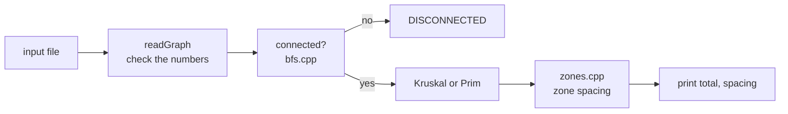

# The application: from input to output

**Files:** `app/main.cpp`, `app/generator.cpp`, `src/common/graph.cpp`, `bfs.cpp`, `zones.cpp`, `build.ps1`

## What it does
Reads a campus, builds the cheapest cabling, and splits it into `k` zones.



## Input and output
```
5 7 2          n buildings, m cables, k zones
1 2 2          building, building, cost  (one line per cable)
...
```
Output: two lines, the **total cost** and the **zone spacing**. Or the single word `DISCONNECTED`.

For `tests/sample1.in` the output is `16` and `7`.

## The files

| File | Job |
|---|---|
| `graph.cpp` | `Edge`, `Graph`, `MSTResult` and `readGraph`. Rejects bad input (n < 2, k out of range, building out of range) and converts to 0-based numbers. |
| `bfs.cpp` | `isConnected`: walks out from building 0 and checks that all n buildings are reached. |
| `zones.cpp` | `zoneSpacing`: sorts the n-1 MST cables and returns the one at position n-k. That is the lightest of the k-1 heaviest cables, i.e. the cheapest cable we cut to make k zones. |
| `generator.cpp` | Makes a random campus: buildings at random spots in a 1000 x 1000 square, a cable between any two within the radius, cost = distance x 1000. |
| `main.cpp` | Reads options, runs the chosen algorithm, prints the answer. |

## Zones, in one picture
For sample 1 the MST cables are 2, 3, 4, 7. With k = 2 we cut the heaviest one (7). Two zones remain, `{1,2,3,4}` and `{5}`, and the spacing is **7**.

## Commands
```
.\build.ps1
Get-Content tests\sample1.in | .\run --structure A
Get-Content tests\sample1.in | .\run --structure B
.\run --structure A --no-compress
.\run --generate 1000 60 5 1 > campus.in      # n, radius, k, seed
```
