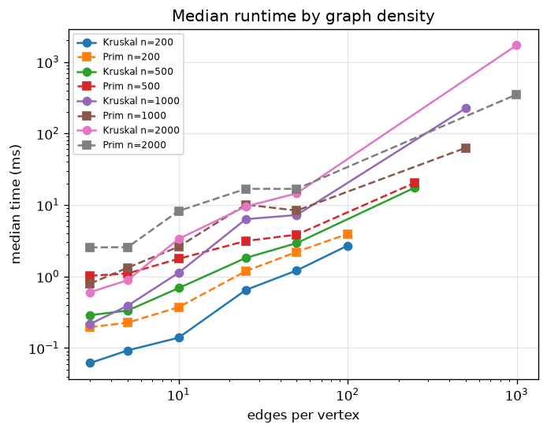

# Measurements: how fast is each algorithm?

**Files:** `bench/benchmark.cpp`, `bench/plot.py`, `bench.ps1` · **Data:** `results/timings_*.csv`, `prim_heap.csv`, `union_find.csv`

## How we measured
* Random connected graphs with n = 200, 500, 1,000 and 2,000 buildings.
* For each n, 6 densities from 3 cables per building up to a complete graph.
* Each setting is run **5 times**; we report the **median** (one slow run cannot spoil it).
* Both algorithms receive the same graph.

## Result



| n | m | Kruskal (ms) | Prim (ms) | Faster |
|---:|---:|---:|---:|---|
| 1,000 | 3,000 | 0.352 | 0.819 | Kruskal (2.3x) |
| 1,000 | 50,000 | 7.276 | 6.697 | Prim (1.1x) |
| 1,000 | 499,500 | 121.151 | 52.835 | Prim (2.3x) |
| 2,000 | 6,000 | 0.780 | 1.873 | Kruskal (2.4x) |
| 2,000 | 1,999,000 | 847.389 | 244.610 | Prim (3.5x) |

**Kruskal wins 17 of 24 settings (the sparse ones). Prim wins 7 (the dense ones).**

## Why
* Kruskal sorts **every** cable first. That is cheap for few cables and expensive for millions.
* Prim only pops what it needs, so it grows more slowly with density.

## Extra measurements
* `prim_heap.csv`: heap size, pushes, pops and stale pops. About 75% of pops on the densest graph are stale.
* `union_find.csv`: path compression makes Kruskal 1% to 8% faster.

## Run it
```
.\bench.ps1
```
Then `python bench\plot.py` writes the charts into `results/figures/`.
