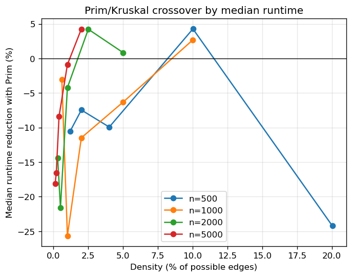

# Hard cases and the crossover

**Files:** `tests/hard_cases.cpp`, `bench/crossover.cpp` · **Data:** `results/crossover.csv`, `results/figures/crossover.png`

## Part 1: graphs designed to break things
Random graphs are friendly. These are not. For each graph both algorithms must agree on the answer and on whether it is connected, and their speed is recorded.

| Case | Why it is hard |
|---|---|
| `chain`, `chain_k_equals_n` | A long path: deep union-find trees; k = n cuts every cable |
| `star` | One building with 20,000 neighbours |
| `complete_equal` | Every cable costs the same: the MST is not unique |
| `tie_heavy_sparse`, `tie_heavy_dense` | Only a few distinct costs, many ties |
| `complete_random`, `dense_stale_heavy` | Huge heaps, many stale pops in Prim |
| `disconnected_big`, `isolated_vertex` | Must print `DISCONNECTED` |
| `two_vertices` | Smallest possible campus |
| `zero_weight_edges`, `huge_weights` | Costs of 0 and very large costs |

Expected last line: `hard cases mismatches: 0`.

## Part 2: where does Prim overtake Kruskal?
We swept the density from 0.5% to 100% of all possible cables for n = 500, 1,000 and 2,000.



| n | Prim first wins at | Prim's lead at 100% |
|---:|---|---:|
| 500 | about 40% density (m = 49,900) | 38.9% |
| 1,000 | about 10% density (m = 49,950) | 57.9% |
| 2,000 | about 5% density (m = 99,950) | 70.4% |

**Answer:** the crossover is not one fixed number. The bigger the campus, the sooner Prim wins. Below that point Kruskal is faster, above it Prim is.

Timings on small graphs are noisy, so read the crossover as a range, not an exact point.

## Run it
```
g++ -std=c++17 -O2 -o hard_cases tests/hard_cases.cpp
.\hard_cases
g++ -std=c++17 -O2 -o crossover bench/crossover.cpp
.\crossover
```
