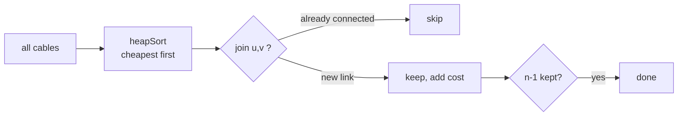
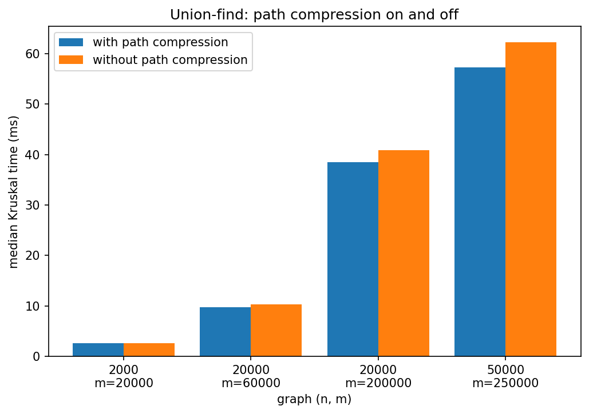

# Structure A: Kruskal

**Files:** `src/structA/heapsort.h`, `unionfind.h`, `kruskal.h` · **Tests:** `tests/test_structA.cpp`

## The idea in one line
Sort all cables from cheapest to dearest. Keep a cable only if it joins two buildings that are not connected yet.



## The three files

| File | Job | Key point |
|---|---|---|
| `heapsort.h` | Sorts the cables by cost | Build a max-heap, then swap the root with the last item and sink the new root. Always O(m log m) |
| `unionfind.h` | Answers "are these two buildings already connected?" | Each group has one leader. `join` returns `false` if both buildings share a leader |
| `kruskal.h` | Puts them together | Stops after n-1 cables. Fewer than n-1 means `DISCONNECTED` |

## The two union-find tricks
* **Rank**: hang the shorter tree under the taller one, so trees stay short. Rank is tree height, not cable cost.
* **Path compression**: while finding a leader, point every building on the way straight at it.

Neither trick changes which cables Kruskal keeps. They only make it faster.

## Example (`sample1`)
Sorted cables: 2, 3, 4, 5, 6, 7, 8. Kept: 2, 3, 4, 7. Total **16**.
The cables 5, 6 and 8 are skipped because they would close a loop.

## Result: does compression help?



| n | m | With (median ms) | Without (median ms) | Gain |
|---:|---:|---:|---:|---:|
| 2,000 | 20,000 | 0.956 | 0.972 | 1.6% |
| 50,000 | 250,000 | 17.493 | 21.909 | 20.2% |

These rows show the first and last settings in [the path-compression results](../../results/union_find.csv), with five timed trials per mode.

## How to check it
From the repository root on Linux/macOS:

```sh
g++ -std=c++17 -O2 tests/test_structA.cpp -o /tmp/test_structA
/tmp/test_structA
```

On Windows, see the [test instructions](../../tests/README.md).
Expected: 212 checks passed.
