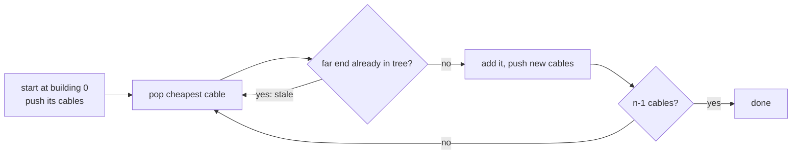
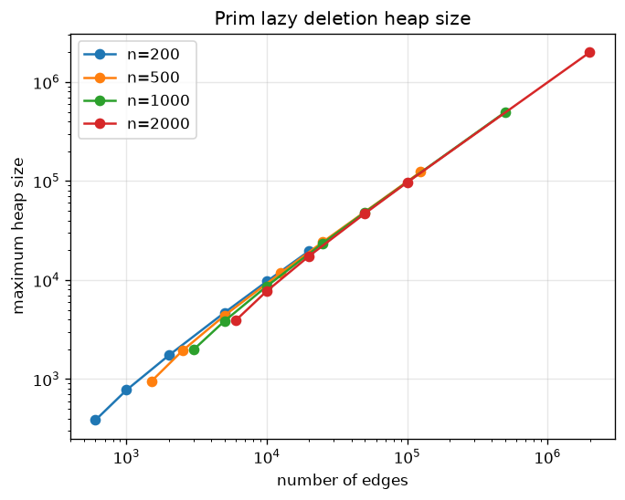

# Structure B: Prim

**Files:** `src/structB/minheap.h`, `prim.h` · **Tests:** `tests/test_structB.cpp`

## The idea in one line
Start at one building and keep adding the cheapest cable that reaches a **new** building, like a tree growing outward.



## The two files

| File | Job |
|---|---|
| `minheap.h` | A binary min-heap of cables (`HeapItem`: cost, from, to). `push` floats an item up, `pop` sinks the last item from the top. |
| `prim.h` | Builds adjacency lists, then runs the loop above. |

## Lazy deletion (the important idea)
When a building joins the tree, older cables that lead to it stay in the heap. We do not remove them. We just skip them when they come out (a **stale pop**). This avoids the harder "decrease-key" operation.

`prim` counts `pushes`, `pops`, `stalePops` and `maxHeap` so we can measure this.

## Example (`sample1`)
From building 1: 1-2 (2), 2-3 (3), 3-4 (4), 4-5 (7). Total **16**, the same as Kruskal.

## Result: what the heap looks like



| n | m | Max heap | Pushes | Pops | Stale pops |
|---:|---:|---:|---:|---:|---:|
| 1,000 | 3,000 | 1,980 | 3,000 | 2,919 | 1,920 |
| 2,000 | 1,999,000 | 1,994,306 | 1,999,000 | 8,053 | 6,054 |

* The heap can grow to almost m entries, so Prim uses O(m) memory.
* On a dense graph Prim stops after only about 8,000 pops, even though 2 million cables went in.

## How to check it
From the repository root on Linux/macOS:

```sh
g++ -std=c++17 -O2 tests/test_structB.cpp -o /tmp/test_structB
/tmp/test_structB
```

On Windows, see the [test instructions](../../tests/README.md).
Expected: 211 checks passed.
