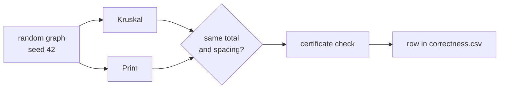

# Correctness and testing

**Files** [`test_all.cpp`](test_all.cpp), [`randomgraph.h`](randomgraph.h), [`test.ps1`](test.ps1), and the sample files · **Data** [`results/correctness.csv`](../results/correctness.csv)

## The question
How do we know both algorithms give the **right** answer, not just the **same** answer?

## Checks on the differential test cases
1. Kruskal and Prim give the same total cost and the same zone spacing.
2. Both agree on whether the graph is connected.
3. **Certificate** (on 1,050 cases): the answer is proven to be a true minimum spanning tree. It must be a tree that touches every building, and no cable left out may be cheaper than a cable on the path it would replace.



## Result: 1,207 cases, 0 failed

| Category | Cases | Passed | Certified |
|---|---:|---:|---:|
| small connected | 400 | 400 | 400 |
| medium connected | 200 | 200 | 200 |
| dense | 100 | 100 | 100 |
| tree | 100 | 100 | 100 |
| special k | 100 | 100 | 100 |
| equal weights (ties) | 150 | 150 | 150 |
| disconnected | 150 | 150 | n/a |
| large connected | 5 | 5 | n/a |
| large disconnected | 2 | 2 | n/a |
| **Total** | **1,207** | **1,207** | **1,050** |

The random seed is fixed, so anyone can repeat the run and get the same table.

## Also tested
`test.ps1` also runs both samples through Kruskal and Prim. `sample1` must print `16` and `7`; the expected answers are saved in `tests/sample*.out`.

## Run it

Run these commands from the repository root. The differential test writes
`results/correctness.csv` relative to its working directory and overwrites an
existing log there.

**Windows PowerShell**

```powershell
.\tests\test.ps1
g++ -std=c++17 -O2 bench/test_adversarial.cpp bench/adversarial_cases.cpp -o test_adversarial.exe
.\test_adversarial.exe
```

**Linux/macOS**

```sh
g++ -std=c++17 -O2 tests/test_structA.cpp -o /tmp/test_structA
g++ -std=c++17 -O2 tests/test_structB.cpp -o /tmp/test_structB
g++ -std=c++17 -O2 tests/test_all.cpp -o /tmp/test_all
g++ -std=c++17 -O2 bench/test_adversarial.cpp bench/adversarial_cases.cpp -o /tmp/test_adversarial
/tmp/test_structA
/tmp/test_structB
/tmp/test_all
/tmp/test_adversarial
for sample in 1 2; do
    for structure in A B; do
        ./run --structure "$structure" < "tests/sample$sample.in" > /tmp/mst-sample.out
        diff -u "tests/sample$sample.out" /tmp/mst-sample.out
    done
done
```

The adversarial suite tests the benchmark graph generator. The crossover
benchmark separately checks both algorithms on those graphs.
