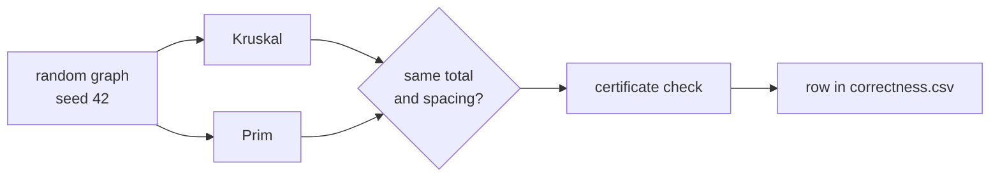

# Correctness and testing

**Files:** `tests/test_all.cpp`, `tests/randomgraph.cpp`, `tests/sample*.in/.out`, `test.ps1`, `TOOLS.md` · **Data:** `results/correctness.csv`

## The question
How do we know both algorithms give the **right** answer, not just the **same** answer?

## Three checks on every random graph
1. Kruskal and Prim give the same total cost and the same zone spacing.
2. Both agree on whether the graph is connected.
3. **Certificate** (on 1,050 cases): the answer is proven to be a true minimum spanning tree. It must be a tree that touches every building, and no cable left out may be cheaper than a cable on the path it would replace.



## Result: 1,207 cases, 0 failed

| Category | Cases | Passed | Certified |
|---|---:|---:|---:|
| small connected | 400 | 400 | 400 |
| medium connected | 200 | 200 | 200 |
| dense | 100 | 100 | 100 |
| tree | 100 | 100 | 100 |
| special k | 100 | 100 | 100 |
| equal weights (ties) | 150 | 150 | 150 |
| disconnected | 150 | 150 | n/a |
| large connected | 5 | 5 | n/a |
| large disconnected | 2 | 2 | n/a |
| **Total** | **1,207** | **1,207** | **1,050** |

The random seed is fixed, so anyone can repeat the run and get the same table.

## Also tested
`test.ps1` also runs both samples through Kruskal and Prim. `sample1` must print `16` and `7`; the expected answers are saved in `tests/sample*.out`.

## Run it
```
.\test.ps1
```
Look for `0 failed`. The log is written to `results/correctness.csv`.
